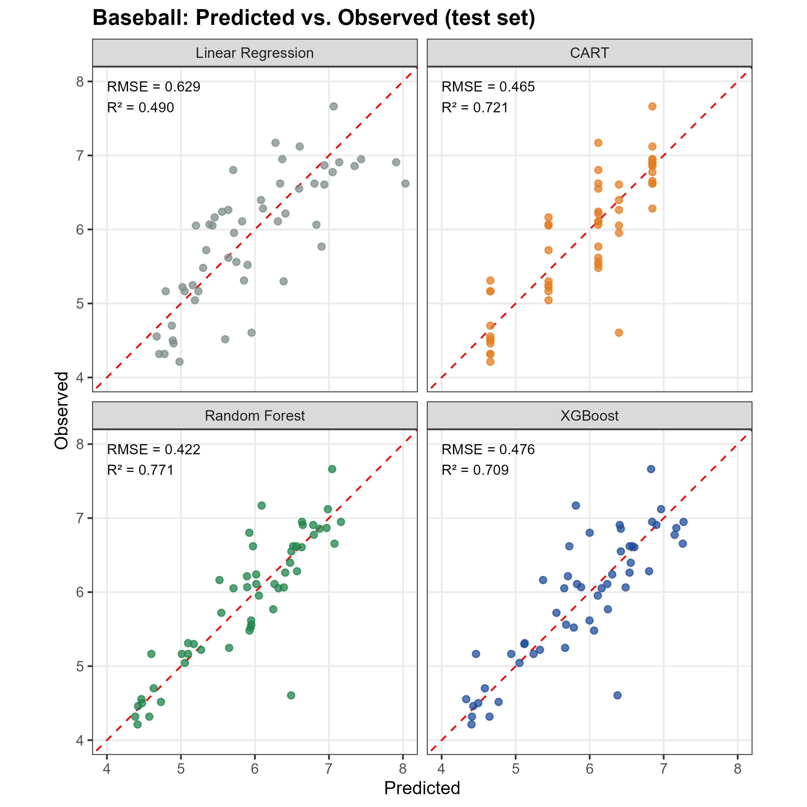
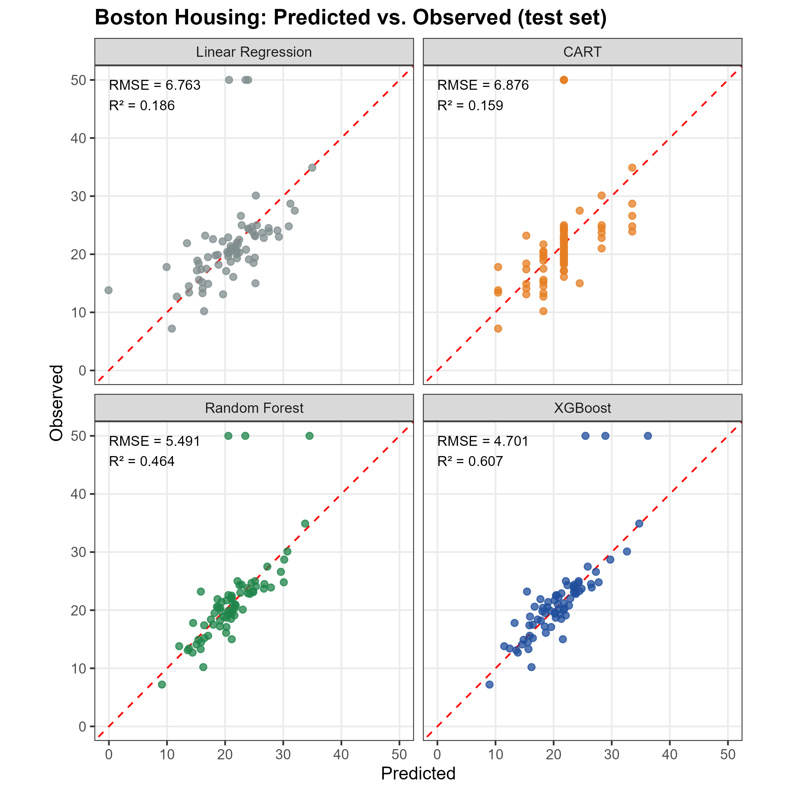
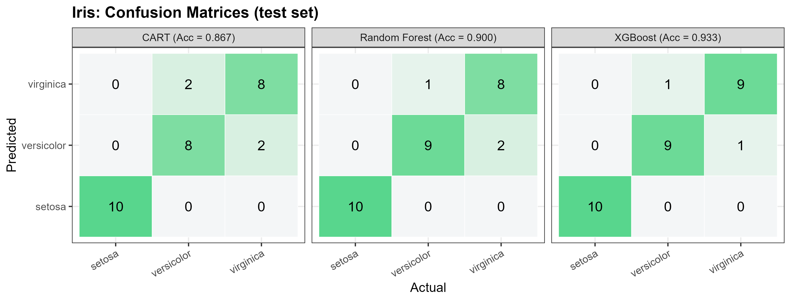
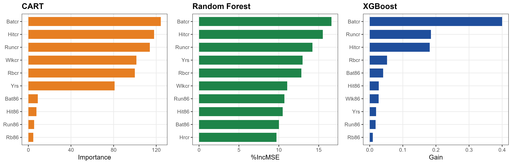

# 決策樹與集成學習實作：CART、Random Forest、XGBoost

機器學習課程作業（2026/11/17）。以三份資料比較單一決策樹 CART 與兩種集成學習方法，迴歸問題另加入多元線性迴歸作為基準：

- **Bagging**：隨機森林（Random Forest）
- **Boosting**：XGBoost

| 資料 | 任務 | 樣本數（訓練／測試） | 反應變數 |
|---|---|---|---|
| Iris | 三類別分類 | 150（120／30） | `Species` |
| Boston Housing | 迴歸 | 506（434／72） | `medv` 房價中位數（千美元） |
| Baseball | 迴歸 | 263（210／53） | `Logsalary = log(Salary)` |

完整的圖表解讀與討論請見報告 [`Ensemble_Learning_HW.docx`](Ensemble_Learning_HW.docx)。

## 主要結果

| 資料（指標） | 線性迴歸 | CART | 隨機森林 | XGBoost |
|---|---|---|---|---|
| Iris（準確率，越高越好） | 不適用 | 0.867 | 0.900 | **0.933** |
| Boston（RMSE，越低越好） | 6.763 | 6.876 | 5.491 | **4.701** |
| Baseball（RMSE，越低越好） | 0.629 | 0.465 | **0.422** | 0.476 |

- 三份資料中，集成方法的表現都優於單一棵決策樹。
- XGBoost 在 Iris 與 Boston 表現最好；在樣本最少的 Baseball 則輸給隨機森林，略差於剪枝後的 CART，顯示 Boosting 在小樣本時較容易過度擬合。
- 變數重要性在三種模型間相當一致：Iris 為花瓣長度與寬度，Boston 為 `rm` 與 `lstat`，Baseball 為生涯累積數據（`Batcr`、`Hitcr`、`Runcr`）。

<p align="center">
  
  
</p>
<p align="center"><sub>左：Baseball　右：Boston Housing　測試資料預測值與實際值</sub></p>

<p align="center">
  
</p>

<p align="center">
  
</p>

## 方法

所有資料以 `set.seed(123)` 搭配 `caTools::sample.split()` 依 80:20 切分訓練／測試資料，與課堂範例程式相同。

| 模型 | R 套件 | 超參數選擇方式 |
|---|---|---|
| 多元線性迴歸 | `stats::glm` | 無（僅迴歸問題） |
| CART | `rpart` | 迴歸：取 10-fold CV 誤差（`xerror`）最小的 `cp` 剪枝 |
| 隨機森林 | `randomForest` | `ntree = 500`；迴歸以 OOB MSE 比較 `mtry = 1, ..., p` |
| XGBoost | `xgboost` | `eta = 0.1`、`nrounds = 200`；迴歸從訓練資料切 20% 驗證集比較 `max_depth = 1, ..., 8` |

選定的超參數：

| 資料 | CART `cp` | RF `mtry` | XGBoost `max_depth` |
|---|---|---|---|
| Boston Housing | 0.0100 | 4 | 3 |
| Baseball | 0.0158 | 3 | 8 |

## 資料夾結構

```
.
├── HW_Ensemble.R             # 主程式：Part A Iris、Part B Boston、Part C Baseball
├── ball.txt                  # Baseball 資料
├── Ensemble_Learning_HW.docx # 作業報告
└── HW_output/                # 程式執行後自動產生
    ├── A1 ~ A6_*.png         # Iris 圖表
    ├── B1 ~ B5_*.png         # Boston Housing 圖表
    ├── C0 ~ C5_*.png         # Baseball 圖表
    ├── all_metrics.csv       # 迴歸模型測試結果
    ├── A_iris_accuracy.csv   # Iris 分類準確率
    ├── results_log.txt       # 模型摘要、調參過程、變數重要性
    └── sessionInfo.txt       # 執行環境
```
